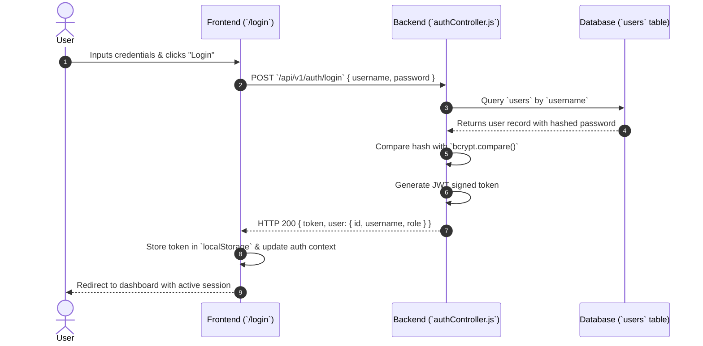
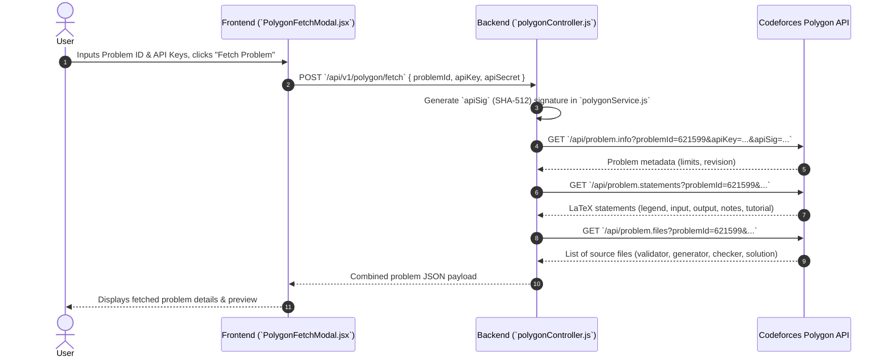
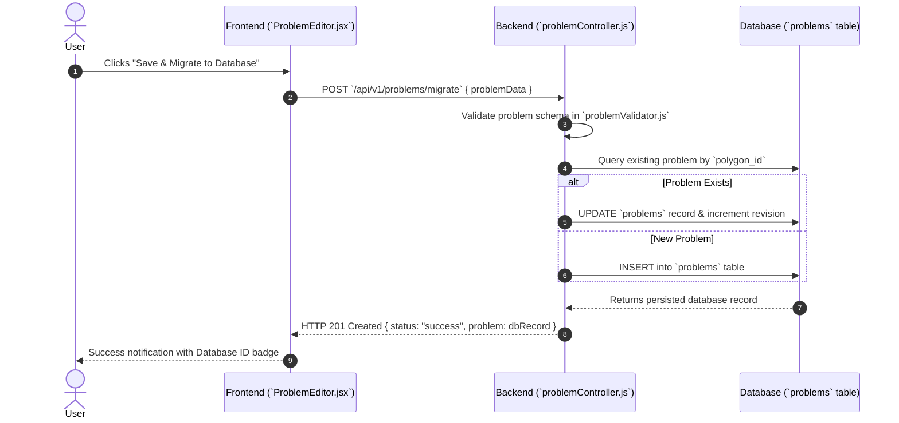
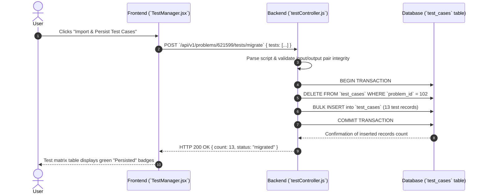
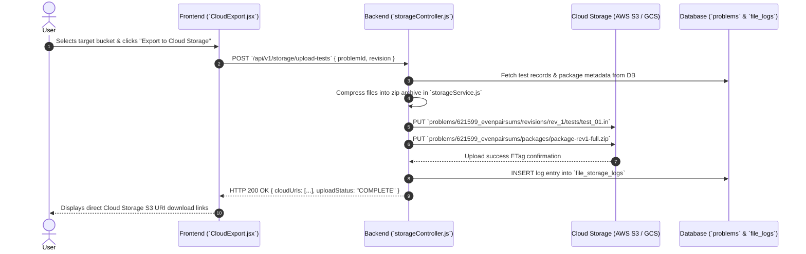
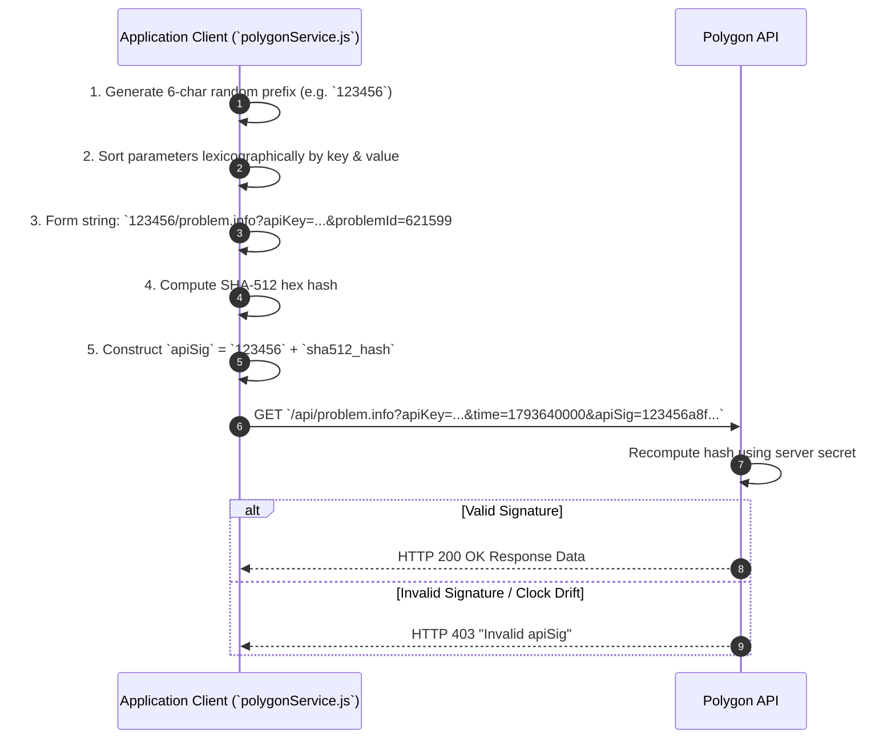

# Problem Packaging & Polygon Integration System — Technical Documentation

This document describes the architectural implementation of the system's user flows, external service integrations, database persistence, and cloud storage organization.

---

## 2.1 User Flows

### Flow 1: User Login



1. **What the user clicks or submits:**
   - Navigates to `/login` page.
   - Enters `username` (or `email`) and `password` in the authentication form.
   - Clicks the **"Sign In"** button.

2. **What data the frontend sends to the backend:**
   - **Endpoint:** `POST /api/v1/auth/login`
   - **Payload:**
     ```json
     {
       "username": "NevedhaVR",
       "password": "userSecretPassword123"
     }
     ```

3. **What the backend does, in order:**
   - Handler function `login()` in `controllers/authController.js` validates payload format.
   - Searches for user record by `username`.
   - Uses `bcrypt.compare()` to verify input password against the stored password hash.
   - On success, signs a JSON Web Token (JWT) using `jwt.sign()` containing `userId`, `username`, and access privileges.
   - Sets secure HTTP headers and returns the token payload.

4. **Which external APIs are called, if any:**
   - *None.*

5. **What is read or written in the database or storage:**
   - **Read:** Queries `users` collection/table for user record matching `username`.
   - **Written:** Updates `last_login_at` timestamp in `users` database table.

6. **What the user sees when the action completes:**
   - Toast notification displaying *"Login successful"*.
   - Automatic redirect from `/login` to the main Problem Management Dashboard (`/dashboard`).

---

### Flow 2: Fetching a Problem from Polygon



1. **What the user clicks or submits:**
   - Opens the **"Fetch from Polygon"** modal.
   - Inputs `problemId` (e.g., `621599`) and optional Polygon API credentials (`apiKey`, `apiSecret`).
   - Clicks **"Fetch Problem Details"**.

2. **What data the frontend sends to the backend:**
   - **Endpoint:** `POST /api/v1/polygon/fetch`
   - **Payload:**
     ```json
     {
       "problemId": "621599",
       "apiKey": "poly_key_abc123",
       "apiSecret": "poly_secret_xyz789"
     }
     ```

3. **What the backend does, in order:**
   - Route handler `fetchPolygonProblem()` in `controllers/polygonController.js` calls `polygonService.getProblemData(problemId)`.
   - Constructs SHA-512 signatures via `generateApiSig(methodName, params, secret)`.
   - Executes parallel requests to fetch problem metadata, LaTeX statement fields, and attached source file manifests.
   - Combines responses into a unified problem model object.

4. **Which external APIs are called, if any:**
   - `GET https://polygon.codeforces.com/api/problem.info`
   - `GET https://polygon.codeforces.com/api/problem.statements`
   - `GET https://polygon.codeforces.com/api/problem.files`

5. **What is read or written in the database or storage:**
   - *Temporary caching:* Writes fetched payload to server in-memory redis cache under `polygon:cache:621599` with a 15-minute TTL.

6. **What the user sees when the action completes:**
   - Spinner closes; problem preview populates with Name (`Even Pair Sums`), legend preview, time limit (1000 ms), memory limit (256 MB), and source file checklist.

---

### Flow 3: Migrating a Problem to the Database



1. **What the user clicks or submits:**
   - Clicks the **"Save & Migrate to Database"** button on the problem edit workspace.

2. **What data the frontend sends to the backend:**
   - **Endpoint:** `POST /api/v1/problems/migrate`
   - **Payload:**
     ```json
     {
       "polygonId": "621599",
       "name": "Even Pair Sums",
       "slug": "evenpairsums",
       "timeLimitMs": 1000,
       "memoryLimitMb": 256,
       "statement": {
         "legend": "You are given an array A of N integers...",
         "inputFormat": "The first line contains N...",
         "outputFormat": "Output a single integer...",
         "notes": "For the first sample...",
         "tutorial": "Iterate through array..."
       }
     }
     ```

3. **What the backend does, in order:**
   - Function `migrateProblem()` in `controllers/problemController.js` checks schema validity via `Joi` / `Zod`.
   - Checks if a record with `polygon_id = 621599` exists in the `problems` table via `ProblemRepository.findByPolygonId()`.
   - If present, executes an `UPDATE` query; otherwise executes an `INSERT`.
   - Emits an internal audit event `PROBLEM_MIGRATED`.

4. **Which external APIs are called, if any:**
   - *None.*

5. **What is read or written in the database or storage:**
   - **Read:** Checks `problems` table for existing `polygon_id`.
   - **Written:** Inserts/Updates row in `problems` table: `id`, `polygon_id`, `name`, `slug`, `statement_json`, `time_limit`, `memory_limit`, `updated_at`.

6. **What the user sees when the action completes:**
   - Green banner displaying *"Problem successfully migrated to database (ID: #db_evenpair_102)"*.

---

### Flow 4: Migrating Test Cases to the Database



1. **What the user clicks or submits:**
   - Navigates to the **Tests** tab.
   - Clicks **"Import & Persist Test Cases"**.

2. **What data the frontend sends to the backend:**
   - **Endpoint:** `POST /api/v1/problems/621599/tests/migrate`
   - **Payload:**
     ```json
     {
       "problemId": "621599",
       "generatorScript": "generator 4 10 > 1\ngenerator 5 20 > 2\n...",
       "tests": [
         { "index": 1, "isExample": true, "input": "4\n1 3 5 7\n", "output": "3\n" },
         { "index": 2, "isExample": true, "input": "5\n2 4 6 8 10\n", "output": "4\n" }
       ]
     }
     ```

3. **What the backend does, in order:**
   - Function `migrateTestCases()` in `controllers/testController.js` validates test index bounds and non-empty input/output data.
   - Begins a database SQL transaction (`db.transaction()`).
   - Removes stale records for the problem: `DELETE FROM test_cases WHERE problem_id = ?`.
   - Performs a bulk insert for all 13 test cases.
   - Commits transaction and logs count.

4. **Which external APIs are called, if any:**
   - *None.*

5. **What is read or written in the database or storage:**
   - **Written:** Replaces records in `test_cases` table (`id`, `problem_id`, `test_index`, `input_data`, `output_data`, `is_sample`, `hash`).

6. **What the user sees when the action completes:**
   - Test table updates showing 13 active test records with status pills changing to **"Database Persisted"**.

---

### Flow 5: Uploading Test Cases to Cloud Storage



1. **What the user clicks or submits:**
   - Navigates to **Packages & Storage** tab.
   - Clicks **"Export to Cloud Storage"**.

2. **What data the frontend sends to the backend:**
   - **Endpoint:** `POST /api/v1/storage/upload-tests`
   - **Payload:**
     ```json
     {
       "problemId": "621599",
       "revision": 1,
       "bucketName": "contest-problems-prod"
     }
     ```

3. **What the backend does, in order:**
   - Handler `uploadTestsToCloud()` in `controllers/storageController.js` reads test cases and problem package archives from disk/DB.
   - Initializes cloud SDK client via `storageService.js` (`AWS.S3` / `@google-cloud/storage`).
   - Streams input/output test files and package `.zip` files to target cloud bucket paths.
   - Verifies checksum hash (MD5/ETag) returned by cloud provider for each uploaded file.
   - Registers uploaded object URIs in database storage logs.

4. **Which external APIs are called, if any:**
   - Cloud Storage API (`s3.upload()` or `gcs.bucket().upload()`).

5. **What is read or written in the database or storage:**
   - **Read:** Reads `test_cases` and `problems` table records.
   - **Written (Cloud Storage):** Writes object files to S3/GCS bucket:
     - `problems/621599_evenpairsums/revisions/rev_1/tests/test_01.in`
     - `problems/621599_evenpairsums/packages/package-rev1-full.zip`
   - **Written (Database):** Inserts record into `file_storage_logs` (`id`, `problem_id`, `s3_key`, `bytes`, `uploaded_at`).

6. **What the user sees when the action completes:**
   - Progress bar hits 100%. User sees success card with S3 object links: `s3://contest-problems-prod/problems/621599_evenpairsums/packages/package-rev1-full.zip`.

---

## 2.2 External Integrations

### Codeforces Polygon API Integration

The application automates problem lifecycle management by communicating with the Codeforces Polygon API.

#### 1. Authentication & Security Protocol

Polygon API requires request signature authentication to ensure request integrity and prevent replay attacks. Every HTTP request sent to Polygon includes three query parameters: `apiKey`, `time`, and `apiSig`.



##### Signature Algorithm Standard Implementation:
```javascript
// Located in services/polygonService.js
const crypto = require('crypto');

function generateApiSig(methodName, params, secret) {
    const rand = Math.random().toString(36).substring(2, 8); // 6-char random string
    
    // Sort keys alphabetically
    const sortedKeys = Object.keys(params).sort();
    const paramPairs = sortedKeys.map(key => `${key}=${params[key]}`);
    const paramString = paramPairs.join('&');
    
    const signatureBase = `${rand}/${methodName}?${paramString}#${secret}`;
    const hash = crypto.createHash('sha512').update(signatureBase).digest('hex');
    
    return `${rand}${hash}`;
}
```

#### 2. Polygon API Endpoints Used

| Endpoint Method | HTTP Method | Implementation File & Function | Purpose & Description |
| :--- | :--- | :--- | :--- |
| `problem.list` | `GET` | `polygonService.js` -> `listProblems()` | Retrieves all problems accessible by the configured API key. |
| `problem.info` | `GET` | `polygonService.js` -> `getProblemInfo()` | Reads time limits, memory limits, and revision count. |
| `problem.statements` | `GET` / `POST` | `polygonService.js` -> `saveStatement()` | Reads or updates LaTeX statement sections (`legend`, `input`, `output`, `notes`, `tutorial`). |
| `problem.files` | `GET` / `POST` | `polygonService.js` -> `uploadSourceFile()` | Lists or uploads source code (`validator.cpp`, `generator.cpp`, `checker.cpp`). |
| `problem.solutions` | `GET` / `POST` | `polygonService.js` -> `uploadSolution()` | Uploads candidate solutions and sets verdicts (e.g. `MAINCORRECT`). |
| `problem.setChecker` | `POST` | `polygonService.js` -> `setChecker()` | Selects built-in checkers (e.g. `std::ncmp.cpp`) or assigns custom checkers. |
| `problem.tests` | `GET` / `POST` | `polygonService.js` -> `saveTestScript()` | Sets test generation script parameters and sample flags. |
| `problem.buildPackage` | `POST` | `polygonService.js` -> `buildPackage()` | Triggers async package compilation (`Full` or `Standard`). |
| `problem.package` | `GET` | `polygonService.js` -> `pollPackageStatus()` | Polls package generation status (`RUNNING`, `READY`, `FAILED`). |

---

### Cloud Storage Integration

The application integrates with cloud object storage (AWS S3 / Google Cloud Storage) to store problem archives, generated inputs/outputs, and compilation logs.

#### 1. File Naming & Organization Hierarchy

To guarantee isolation between multiple problems and revisions, files are stored strictly using the following directory layout:

```
cloud-storage-root/
└── problems/
    └── {problem_id}_{problem_name_slug}/
        ├── revisions/
        │   └── rev_{revision_number}/
        │       ├── statements/
        │       │   ├── statement.tex
        │       │   └── tutorial.tex
        │       ├── sources/
        │       │   ├── validator.cpp
        │       │   ├── generator.cpp
        │       │   ├── checker.cpp
        │       │   └── solution_main.cpp
        │       └── tests/
        │           ├── test_01.in
        │           ├── test_01.ans
        │           ├── test_02.in
        │           ├── test_02.ans
        │           └── script.txt
        └── packages/
            ├── package-rev{revision_number}-standard.zip
            └── package-rev{revision_number}-full.zip
```

#### 2. Naming Conventions

* **Root Problem Folder:** `{problem_id}_{problem_name_slug}`
  - *Example:* `621599_evenpairsums`
* **Test Case Files:** Formatted with 2-digit zero padding:
  - Input file: `test_{index_padded}.in` (e.g., `test_01.in`)
  - Answer file: `test_{index_padded}.ans` (e.g., `test_01.ans`)
* **Source Files:** Retain standard role-based lower-case names:
  - Validator: `validator.cpp`
  - Generator: `generator.cpp`
  - Checker: `checker.cpp`
  - Main Solution: `solution_main.cpp` *(avoids namespace collision with `main.cpp`)*
* **Package Archives:** Deterministic revision archive naming:
  - Format: `package-rev{revision_number}-{type}.zip`
  - *Example:* `package-rev1-full.zip`